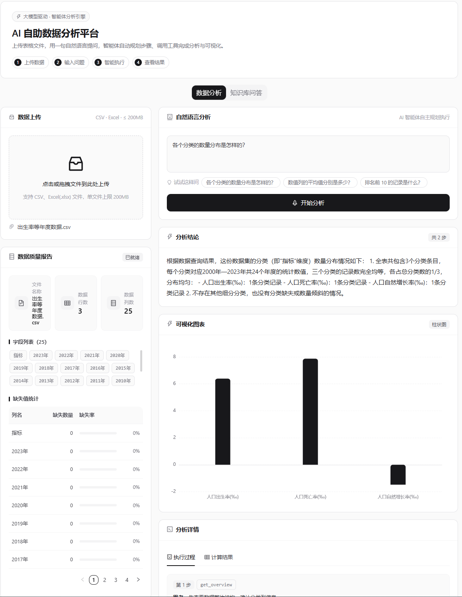
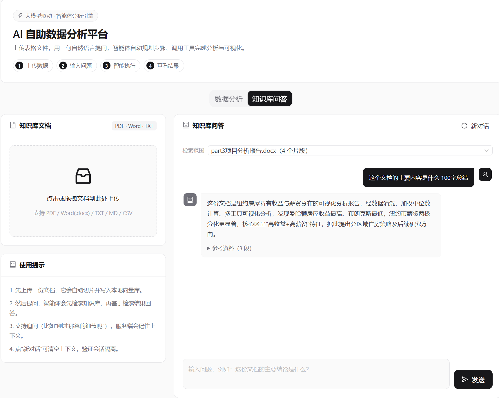
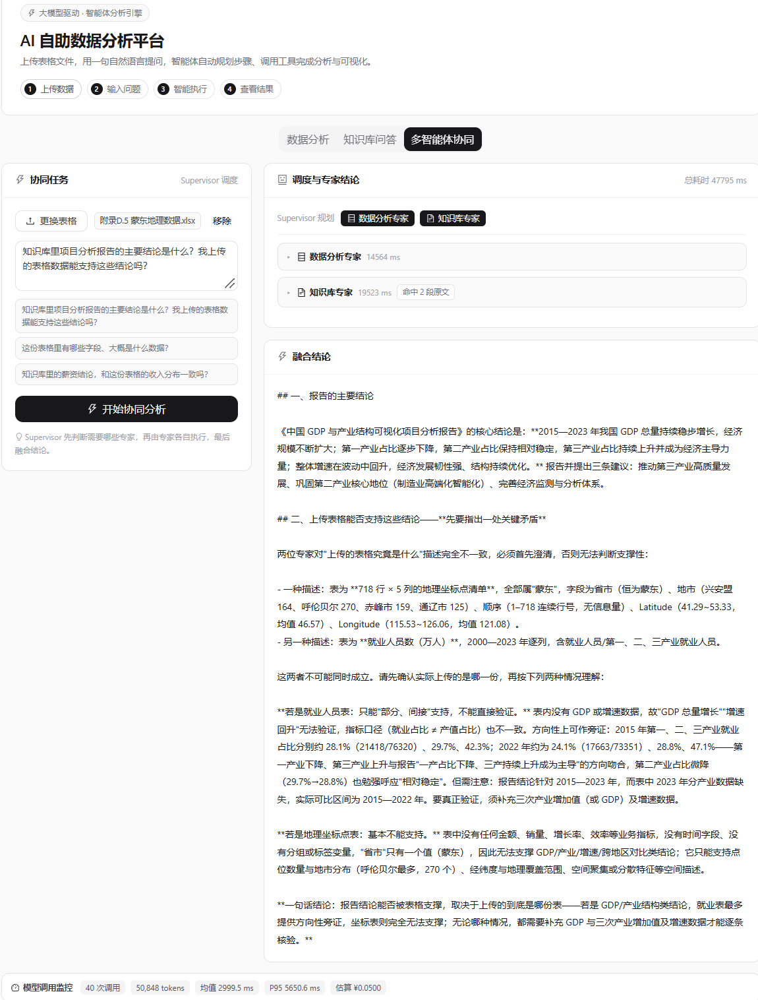
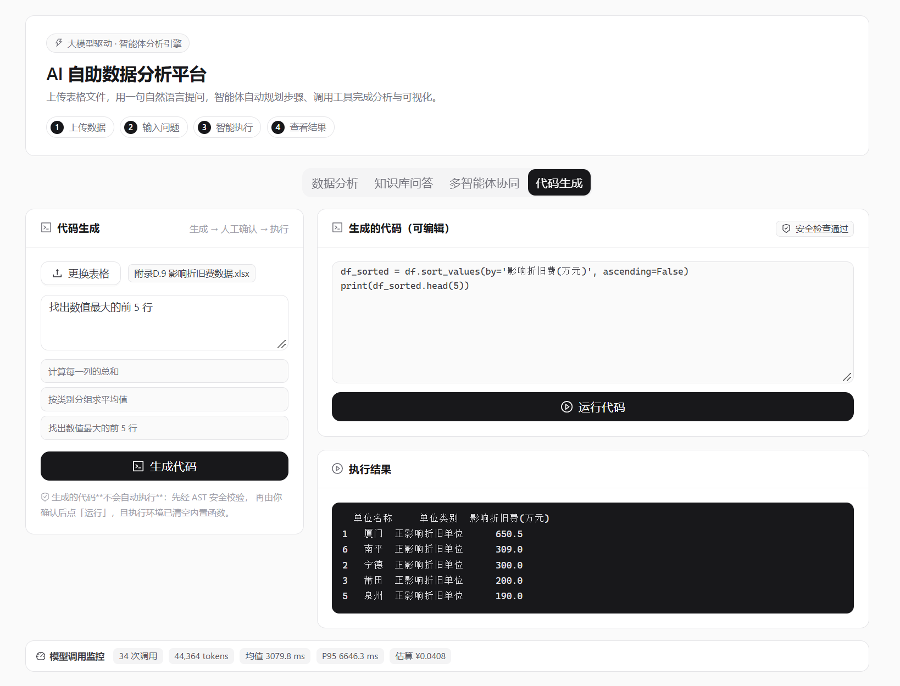

# AI 智能应用平台

[](https://github.com/Vv826/llm-data-analyst-agent/actions/workflows/test.yml)
[](https://github.com/Vv826/llm-data-analyst-agent/actions/workflows/docker.yml)


基于大模型的一站式数据与文档智能处理平台，包含自然语言数据分析 Agent、RAG 知识库问答、多智能体协同、AI 代码生成四大模块。
后端 FastAPI + LangChain/LangGraph（原生 tool calling + `StateGraph` 多智能体），前端 React 19 + Ant Design，
向量检索基于 ChromaDB 与本地 ONNX 嵌入模型。项目配套检索评测体系、可观测性告警、MCP Server 标准化输出、
70 个单元测试、GitHub Actions CI 与 Docker 一键部署。

## 界面预览

**数据分析（Agent 模式）**



**知识库问答（RAG）**



**多智能体协同（Supervisor）**



**AI 代码生成（受限执行）**



## 核心功能

### 模块一：AI 自助数据分析（Agent 模式）
- 支持 CSV / Excel(.xlsx) 上传，自动生成数据质量报告（行列数、字段列表、缺失率）
- 自然语言提问，智能体自主规划步骤并调用工具完成分析
- 内置 5 个工具：数据概览、统计计算、分组聚合、条件过滤、排序
- 自动生成可视化图表（柱状图 / 折线图 / 饼图）
- 完整展示执行链路：每步的推理摘要、调用的工具、传入的参数

### 模块二：RAG 知识库问答
- 支持 PDF / Word(.docx) / TXT / MD / CSV 上传，自动切片写入本地向量库
- **检索器工具化**：Agent 自主决定何时检索、用什么查询检索
- **检索范围可控**：可限定只在某一份文档内检索，避免多文档之间"串味"
- **多轮对话**：基于 LangGraph checkpointer，按 session_id 记忆上下文
- 回答附带检索到的原文片段，支持溯源

### 模块三：多智能体协同（Supervisor）
- **规划节点**：判断一个问题需要哪些专家（数据分析 / 知识库检索）
- **两个专家节点**：分别复用模块一的 pandas 工具集与模块二的 RAG 两阶段检索
- **汇总节点**：融合多方结论并**明确指出互相矛盾之处**；只有一位专家时自动跳过汇总调用
- 支持跨模块任务，例如"知识库里的结论，和我上传的表格数据对得上吗？"—— 单 Agent 做不到
- 返回完整调度链路：规划结果、各专家结论与耗时、检索到的原文

### 模块四：AI 代码生成（受限执行）
- 自然语言 → pandas 代码，生成后**展示给用户确认，不自动执行**
- 三层安全：AST 静态校验 → 人工确认 → 清空内置函数的受限执行环境（接口层再校验一次）
- 生成的代码**可手动编辑**后再运行，便于用户微调
- 执行结果以等宽字体展示；模型会自行排除非数值列

## MCP Server（把能力开放给任意 MCP 客户端）

除了内置 Web 界面，本项目还把**表格分析工具与知识库检索**暴露成标准 [MCP](https://modelcontextprotocol.io) Server —— 任何支持 MCP 的客户端（Claude Desktop、Cursor、自研 Agent……）接上就能用，**无需修改本项目一行代码**。

**暴露 7 个工具**：`list_tables` / `table_overview` / `table_stats` / `group_aggregate` / `filter_rows` / `sort_rows` / `search_knowledge_base`（含两阶段重排）

**启动与自测**：

```bash
venv\Scripts\python.exe mcp_server.py       # stdio 传输，由 MCP 客户端拉起
venv\Scripts\python.exe mcp_smoke_test.py   # 端到端自测：握手 → 列工具 → 真实调用
```

**接入 Claude Desktop**（编辑 `claude_desktop_config.json`）：

```json
{
  "mcpServers": {
    "ai-data-platform": {
      "command": "C:\\path\\to\\ai-data-project\\venv\\Scripts\\python.exe",
      "args": ["C:\\path\\to\\ai-data-project\\mcp_server.py"]
    }
  }
}
```

> ⚠️ **一个容易踩的坑**：MCP 客户端会以**任意工作目录**拉起 server 进程，所以 `mcp_server.py` 内部一律用绝对路径定位 `uploads/`，不能依赖 `os.getcwd()`。自测脚本特意验证了这一点。

## 技术栈

| 层次 | 技术选型 |
| --- | --- |
| 后端框架 | FastAPI 0.142 + Uvicorn |
| 智能体编排 | LangChain 1.4 + LangGraph 1.2（`create_agent` + 原生 tool calling + `StateGraph` 多智能体协同） |
| 大模型 | 字节豆包（火山方舟，OpenAI 兼容接口），通过 `langchain-openai` 的 `ChatOpenAI` 接入 |
| 向量库 | ChromaDB 1.5（本地持久化），`langchain-chroma` 集成 |
| 嵌入模型 | ONNX 版 all-MiniLM-L6-v2（384 维，本地推理，无需外部 API） |
| 数据处理 | pandas 3.0 + numpy + openpyxl + chardet（自动探测 CSV 编码） |
| 文档解析 | pypdf（PDF）、python-docx（Word） |
| 工具协议 | MCP 2.3（`MCPServer`，stdio 传输）—— 7 个工具开放给任意 MCP 客户端 |
| 部署 | Docker Compose：后端 Python 镜像 + 前端**多阶段构建**（Node 编译 → Nginx 托管，镜像约 50MB） |
| 前端 | React 19 + Vite 8 + Ant Design 6 + ECharts 6（黑白灰单色主题，CSS 变量驱动） |

## 架构

```
数据分析链路
  浏览器
    └─ POST /upload     pandas 解析 + chardet 探测编码 → 数据质量报告
    └─ POST /analyze    create_agent（LangGraph）循环：
                          推理摘要 → 调用工具 → 观察结果 → 再推理
                          （原生 tool calling，非手写 JSON 协议）
                        工具：get_overview / get_stats / group_agg / filter / sort
        返回            final_answer + chart + tool_history + result

RAG 知识库链路
  浏览器
    └─ POST /rag/upload  文档解析 → RecursiveCharacterTextSplitter 切片
                         → ONNX 本地嵌入 → Chroma upsert（ID 含内容摘要，重传幂等）
    └─ POST /rag/chat    create_agent + 检索工具 + checkpointer(thread_id = session_id)
                         → 向量召回 top10 → LLM 重排取 top3 → 基于原文生成回答
        返回            answer + related_docs

多智能体协同链路
  浏览器
    └─ POST /multi/analyze  LangGraph StateGraph：
                              plan（规划需要哪些专家）
                                ├─ data_expert  复用 pandas 工具集
                                └─ kb_expert    复用 RAG 两阶段检索
                              summarize（融合，仅一位专家时跳过）
        返回                  plan + findings[] + answer

AI 代码生成链路
  浏览器
    └─ POST /code/generate  模型生成 pandas 代码（**只生成，不执行**）
    └─ POST /code/run       AST 安全校验 → 受限命名空间 exec → 返回 stdout
        返回                  code / safe + issues / output
```

## 技术亮点

1. **原生 tool calling，而非手写协议**：工具用 `@tool` 装饰器定义，参数 JSON Schema 由**函数签名与 docstring 自动生成**，无需在提示词里手写参数说明，改代码不会出现"文档漂移"。
2. **参数隔离**：`df` 等运行时对象通过闭包注入，**对模型完全不可见**，模型只能填它该填的参数（线程安全，无全局状态）。
3. **确定性图表推导**：图表字段从工具调用参数推导（`group_agg` 的分组列/聚合列），而不是让模型猜 x/y 字段 —— 修掉了"图与结论对不上"的问题。
4. **服务端多轮记忆（SQLite 持久化）**：`SqliteSaver` + `thread_id`，会话隔离，不依赖前端传历史，**重启服务后对话记录依然在**。连接必须传 `check_same_thread=False` —— FastAPI 的同步接口跑在线程池里，而 SQLite 连接默认只允许创建它的线程使用；初始化失败会自动降级为内存记忆，保证服务不会因此起不来。
5. **检索范围可限定**：`/rag/chat` 支持按文档过滤检索（Chroma metadata filter）。在嵌入模型对中文区分度有限的情况下，这把"问 A 文档却答成 B 文档"从概率问题变成了确定性问题。
6. **零重依赖的本地嵌入**：用自定义 `Embeddings` 包装 Chroma 自带的 ONNX 函数，复用已下载的模型（86MB），避免引入 `sentence-transformers + torch`（约 2GB）。
7. **工程健壮性**：分块落盘 + 上传大小限制、DataFrame 缓存（按 mtime 校验）、路径穿越防御、NaN/Inf 归一化为 `null`、大模型调用超时与自动重试、docx 解析重名防御。
8. **两阶段检索（向量宽召回 + LLM 重排）**：先召回 top-10，再由大模型重排取 top-3。关键是提示词设计 —— 要求模型"**给所有候选排序**"而不是"**筛选出前 3 段**"，后者会让模型丢掉相关片段；并对排序任务**关闭思考链**，单次重排从 94.8 秒降到 2.1 秒，答案完全一致。
9. **大模型调用可观测性（监控 + 告警）**：用 LangChain callback 捕获每一次底层模型调用的耗时与 token，聚合出调用次数 / 总 token / 平均与 P95 延迟 / 估算成本，经 `/metrics` 暴露并在前端展示，按 `analyze` / `rag` / `rerank` / `multi/*` 分类统计；重排的回退分支也会上报失败指标，避免"静默降级"。并且**带阈值告警**：单次耗时、失败率、token 预算三类超限时，`/metrics` 会返回 `alerts` 列表，前端监控条显示红色标记。**阈值全部可用环境变量配置**，且告警的"判定"与"通知"分离（当前做判定与展示，通知渠道属于外层系统）。
10. **模型层可插拔**：`base_url` / `api_key` / `model` 全部配置化，换模型或供应商只改 `.env`；可为"检索重排"单独指定更轻量的模型。针对不同厂商"关闭思考链"参数名不一致的问题，做了**自动降级重试**（参数被拒就去掉它重试一次）。
11. **多智能体协同（手写 LangGraph Supervisor）**：规划节点判断需要哪些专家，条件路由把任务交给 `data_expert` / `kb_expert`，最后由汇总节点融合；专家节点**复用**已有的工具集与检索器，不重复造轮子。调度链路完全可见 —— 前端展示规划结果、每位专家的耗时与结论、检索到的原文。**专家节点并行执行**（`_route_after_plan` 返回列表即 fan-out），靠 `Annotated[list, operator.add]` reducer 安全合并并发结果；实测跨模块问题总耗时从 77 秒优化到 49 秒。
12. **MCP Server 标准化输出**：把 6 个表格分析工具 + 知识库检索实现为标准 MCP Server，任意 MCP 客户端（Claude Desktop / Cursor）可直接复用；并用官方 SDK 的客户端写了端到端自测（握手 → 工具发现 → 真实调用）。**服务端不依赖工作目录**（全部用绝对路径），这是 MCP 客户端拉起子进程时的真实约束。
13. **关键路径单元测试**：用 pytest 覆盖切片完整性、NaN/Inf 归一化（否则前端 `JSON.parse` 会崩）、路径穿越防御、重排输出解析容错、5 个分析工具与确定性图表推导、上传校验与数据质量报告，以及接口层（FastAPI `TestClient`）。**45 个用例全部不依赖大模型，11 秒跑完** —— 可进 CI，运行成本为零。
14. **工具集覆盖"元数据类问题"**：知识库同时暴露 `search_knowledge_base`（语义检索）与 `list_knowledge_documents`（真实文档清单）。起因是实测发现模型会把"知识库里有哪些文档"当成检索问题，从 top-3 片段里**过度概括**（把 6 份文档说成 2 份）—— 元数据类问题应当由工具直接给出准确答案，而不是让检索去猜。
15. **AI 代码生成 + 受限执行（安全优先）**：用户用自然语言描述需求，模型生成 pandas 代码，但**绝不自动执行**。三层防御：① **AST 静态校验**（禁 import、禁下划线属性、禁 `eval`/`exec`/`open`/`getattr` 等危险调用）；② **人工确认**（代码展示在可编辑框里，用户点「运行」才执行）；③ **受限命名空间**（清空 `__builtins__`，只注入白名单内置函数与 `df` 副本），且接口层会**再次校验**，不信任前端传来的代码。用 10 个真实攻击向量（`__import__('os')`、`df.__class__`、`getattr` 逃逸等）做了攻击性测试。

## 效果评测

RAG 检索质量用 `eval/run_eval.py` 在 14 条人工标注问答上评测（知识库 23 个片段、召回 top-10）：

| 阶段 | Hit@1 | Hit@3 | MRR | 单次重排耗时 |
| --- | --- | --- | --- | --- |
| 纯向量检索（基线） | 28.6% | 92.9% | 0.571 | — |
| + LLM 重排（初版） | 92.9% | 100% | 0.952 | 94.8s |
| **+ 关闭思考链 + 全量排序（最终）** | **100.0%** | **100.0%** | **1.000** | **2.1s** |

> **Hit@1** = 正确文档排在第一位的比例；**Hit@k** = 正确文档出现在前 k 条的比例；**MRR** = 平均倒数排名（排第 1 得 1 分，排第 3 得 0.33 分）。

评测还揭示了两点：召回数从 5 提到 10 后 **Recall@10 达到 100%**（Recall@5 只有 85.7%）；关闭思考链后重排从 94.8s 降到 2.5s，但"筛选前 3 段"的提示词会让 Hit@1 掉到 64.3% —— 说明**瓶颈在任务设计，不在模型的推理能力**。

### 切片算法对比（`eval/chunk_experiment.py`）

同一份文本、同一个嵌入模型、同一套 14 条评测问答，只改变切片策略（向量召回 top-10）：

| 策略 | 片段数 | 平均长度 | Hit@1 | Hit@3 | Recall@10 | MRR |
| --- | --- | --- | --- | --- | --- | --- |
| A 固定 300 字（无重叠） | 37 | 202 | **50.0%** | 71.4% | 92.9% | **0.636** |
| **B 递归 500+50（当前方案）** | 21 | 366 | 42.9% | 57.1% | **100.0%** | 0.568 |
| C 递归 1000+100 | 12 | 639 | 35.7% | 57.1% | 100.0% | 0.517 |
| D 按段落切（≤700） | 15 | 500 | 14.3% | 28.6% | 85.7% | 0.312 |

**结论：保留 B（当前方案）。理由是"评价指标要跟着架构走"：**

- 这条链路的排序由 **LLM 重排**负责（重排后 Hit@1 达到 100%），所以切片策略的核心 KPI 不是 Hit@1，而是 **Recall@10 —— 能不能把正确文档召进候选池**。候选池里没有的东西，重排再强也救不回来。
- A 的 Hit@1 更高（50.0%），但 **Recall@10 只有 92.9%**：有 1 题的正确文档完全没被召回，**这是重排无法弥补的硬伤**。
- B / C 的 Recall@10 = 100%，而重排能把它们的排序全部修正到第一位。

另外两个值得记录的现象：

- **片段越大、排序越差**（A 50.0% > B 42.9% > C 35.7%）：大片段带来更多上下文，但会**稀释语义**，向量匹配反而变糊。
- **"按段落切"最差**（Hit@1 14.3%、Recall@10 85.7%）：这些文档是"项目分析报告"，段落长短悬殊，按边界合并后**单个片段里混了多个主题**，语义被污染。

> ⚠️ **实验前提（如实说明）**：原始上传的文档存的是临时文件、已被删除，实验文本是**从向量库按片段序号重建**的（去重叠后约为原文的 60%）。因此**跨策略的横向对比有效，但绝对数值不能与线上基线直接比较**（线上基线 Hit@1 = 21.4%，而实验里同为 500+50 的 B 是 42.9%，差异来自重建文本不同）。评测集 14 条，样本量也有限。

### 多智能体协同的性能优化（`eval/multi_check.py`）

同一个跨模块问题（"知识库报告的结论，和我上传的表格数据对得上吗？"）的优化过程：

| 版本 | 专家执行 | 规划 + 汇总 | 总耗时 |
| --- | --- | --- | --- |
| 串行 + 全开思考链 | 21s + 29s = 50s（**相加**） | 27s | **77.2s** |
| 并行 fan-out + 全开思考链 | max(22.7, 41.1) = 41s | 44s | 85.5s |
| **并行 + 汇总关闭思考链（最终）** | max(20.5, 38.8) = **38.8s** | **10.5s** | **49.3s** |

**两个优化点：**

1. **专家并行（fan-out / fan-in）**：`_route_after_plan` 返回**列表**即可让多个专家节点同时执行，两条边都指向 `summarize` 即完成汇聚。实测两个专家**同时起跑**（时间线完全重叠 20.5 秒），专家阶段耗时从"两者相加"变为"取最大值"。能安全并行的前提是 `findings` 用了 `Annotated[list, operator.add]` **reducer** —— 并发追加结果时会被合并而不是互相覆盖。
2. **汇总关闭思考链**：`summarize` 是"忠实合并"而非"推理"任务，加上 `no_thinking=True` 后规划+汇总从 44 秒降到 10.5 秒（与检索重排同理）。

> ⚠️ **验证方法很重要**：只看总耗时会**误判**（上游模型波动会掩盖并行效果）。给两个专家节点加上墙上时钟时间戳后，才能用"**区间是否重叠**"来判断是否真并行 —— 这是并发优化的正确验证方式。

## 快速开始

### Docker 一键启动（推荐）

```bash
# 先准备好 .env（复制 .env.example 并填入 Key）
docker compose up -d
```

- 前端：http://localhost:5173
- 后端接口文档：http://localhost:8000/docs
- 首次构建约 10 分钟（下载基础镜像 + 安装依赖），之后启动只需几秒
- `uploads/`、`chroma_db/`、`models/`、`data/` 都通过**卷挂载**，容器重建数据不丢，嵌入模型也不用在容器里重新下载
- 推送到 main 时，CI 会自动构建两个镜像验证 Dockerfile（`.github/workflows/docker.yml`）

> ⚠️ **国内网络注意**：两个 Dockerfile 的基础镜像都加了国内镜像源前缀（`docker.m.daocloud.io/library/`），否则会卡在 `auth.docker.io` 认证超时。想换回官方源，把该前缀删掉即可。

### 环境要求
- **Docker Desktop**（一键启动方式），或
- Python 3.10+（开发环境 3.12）+ Node.js 18+（本地开发方式）
- 豆包大模型 API Key（火山方舟）

### 后端（本地开发）

```bash
python -m venv venv
venv\Scripts\python.exe -m pip install -r requirements.txt

# 配置密钥：复制模板并填入自己的 Key
copy .env.example .env

# 启动（必须在项目根目录）
venv\Scripts\python.exe -m uvicorn main:app --reload --port 8000
```

- 接口文档：http://127.0.0.1:8000/docs
- ⚠️ 必须在**项目根目录**启动：`uploads/`、`chroma_db/`、`models/`、`.env` 都按当前工作目录解析
- ⚠️ 首次使用知识库问答时，会自动下载约 80MB 的嵌入模型到 `models/`（已 gitignore）

### 前端

```bash
cd frontend
npm install
npm run dev
```

页面地址：http://localhost:5173

### 测试

```bash
venv\Scripts\python.exe -m pytest -q
```

70 个单元测试用例，**全部不调用大模型**，约 3 秒跑完（不需要 API Key 也能跑）。

**覆盖率约 56%** —— `codegen.py` 100%、`observability.py` 88%、`main.py` 48%（后者大量接口需要大模型，无法单测）。
CI 用 `--cov-fail-under=50` 做**覆盖率门槛**：跌破 50% 会直接让流水线变红。

CI 环境（GitHub Actions）没有本地的嵌入模型与向量库，因此通过 `KB_DISABLED=1` 显式关闭知识库，
依赖知识库的 3 个用例会**自动跳过**（`requires_kb` 标记），其余 67 个照常执行 —— 见 `.github/workflows/test.yml`。

> 徽章里的覆盖率是**快照值**；真实数值由 CI 每次统计并强制门槛。想要自动更新的徽章可接入 Codecov。
> 另外 `.github/workflows/docker.yml` 会在推送到 main 时**自动构建两个镜像**，用来验证 Dockerfile 没被改坏。

## 配置项

| 环境变量 | 默认值 | 说明 |
| --- | --- | --- |
| `LLM_BASE_URL` | 火山方舟地址 | OpenAI 兼容接口地址（换供应商只改这里） |
| `LLM_API_KEY` | 无（必填） | API Key；未配置时自动回退到 `ARK_API_KEY` |
| `LLM_MODEL` | 内置接入点 | 模型 / 接入点 ID；未配置时回退到 `ARK_MODEL` |
| `RERANK_MODEL` | 同 `LLM_MODEL` | 可选：给检索重排单独指定更轻量的模型 |
| `LLM_DISABLE_THINKING_JSON` | `{"thinking":{"type":"disabled"}}` | 关闭思考链的请求参数，留空则不发送 |
| `MAX_UPLOAD_MB` | `200` | 单文件上传大小上限 |
| `DF_CACHE_SIZE` | `3` | DataFrame 内存缓存条数 |
| `ALERT_LATENCY_MS` | `60000` | 单次模型调用耗时告警阈值（毫秒） |
| `ALERT_FAIL_RATE` | `0.2` | 模型调用失败率告警阈值 |
| `ALERT_TOKENS` | `200000` | 累计 token 告警阈值 |
| `CHAT_DB_PATH` | `chat_memory.sqlite3` | 会话记忆 SQLite 文件路径（本地数据，已 gitignore） |

> **模型层可插拔**：`LLM_BASE_URL` + `LLM_API_KEY` + `LLM_MODEL` 三项即可切到任意 OpenAI 兼容服务（DeepSeek、通义、智谱等）。火山方舟本身也聚合了 DeepSeek / 智谱的模型，切换时连 `base_url` 都不用改。

## 项目结构

```
ai-data-project/
├── main.py                  # 后端全部接口（上传 / Agent 分析 / RAG 问答）
├── observability.py         # 大模型调用指标（token / 延迟 / 成本 / 告警）
├── codegen.py               # AI 代码生成的安全校验与受限执行
├── mcp_server.py            # MCP Server：把工具开放给任意 MCP 客户端
├── mcp_smoke_test.py        # MCP 端到端自测（官方 SDK 客户端）
├── Dockerfile               # 后端镜像（Python 3.12-slim + libgomp1）
├── docker-compose.yml       # 一键启动：后端 + 前端 nginx
├── .dockerignore            # 排除 venv / models / node_modules，否则镜像几个 GB
├── tests/                   # pytest 单元测试（70 个用例，不依赖大模型）
├── eval/                    # 检索评测：qa_set.json 评测集 + run_eval.py
│                            #   + chunk_experiment.py 切片对比 + multi_check.py 多智能体并行验证
├── requirements.txt
├── .env.example             # 配置模板（复制为 .env 后填密钥）
├── README.md
├── docs/                    # README 截图
├── models/                  # 本地嵌入模型缓存（gitignore，约 86MB）
├── chroma_db/               # 向量库持久化目录（gitignore）
├── uploads/                 # 上传的表格文件（gitignore）
└── frontend/
    ├── src/
    │   ├── App.jsx          # 数据分析页 + 模块切换
    │   ├── RagPanel.jsx     # 知识库问答页
    │   ├── MultiPanel.jsx   # 多智能体协同页
    │   ├── CodePanel.jsx    # 代码生成页
    │   ├── MetricsBar.jsx   # 模型调用监控条
    │   ├── App.css
    │   └── index.css        # 设计变量与全局样式
    ├── Dockerfile           # 多阶段构建：Node 编译 → Nginx 托管
    ├── nginx.conf           # SPA 回落 + /api 反向代理到后端
    └── package.json
```

## 已知限制

- **嵌入模型是英文模型**（all-MiniLM-L6-v2），对中文的语义区分度很低。实测：不同主题的中文句向量余弦相似度全部挤在 **0.47 ~ 0.60**（连"今天天气怎么样"与"就业人口"都有 0.47），而同内容用英文时分布为 **0.003 ~ 0.26**。结果是**跨文档检索结果不稳定**。当前通过"限定检索范围"规避；要根本解决需换成中文嵌入模型（如 `bge-small-zh-v1.5`，或火山方舟的 embedding 接入点）并重建向量库。
- 会话记忆已用 SQLite 持久化（`chat_memory.sqlite3`），但**没有过期清理机制** —— 会话多了这个文件会持续增长，生产环境需要按时间清理旧会话。
- 单次 RAG 问答耗时约 30 秒：Agent 模式需要两次模型调用（决定检索 + 生成答案），且该模型每轮输出较多推理 token；重排本身只占约 2 秒。若追求低延迟可改为固定"检索 → 生成"链。
- 不支持老式 `.xls`（需 `xlrd`），请用 Excel 另存为 `.xlsx`。
- 可观测性指标存在**进程内存**里（环形缓冲，最多 300 条），重启即清空；告警按**全量缓冲口径**判定，不是时间窗口。生产环境应换成 Prometheus + 时间窗口 + 通知渠道（钉钉/webhook）。
- AI 生成的代码是**进程内 `exec`**：已做 AST 静态校验 + 清空内置函数，但**没有进程隔离与执行超时** —— 死循环或极端耗内存的代码仍可能拖垮服务。生产环境应改为子进程/容器隔离并加资源限额（如独立沙箱服务、gVisor）。

## 开发笔记

迁移到 LangChain 过程中踩到并记录的坑，供参考：

1. **`chromadb-client` 与 `chromadb` 共用同一个 `chromadb/` 命名空间**。装了前者会写入 `chromadb/is_thin_client.py`，使完整版误判为瘦客户端，`PersistentClient` 直接抛 `http-only client mode`，**整个后端在 import 阶段就崩**。且不能用 `pip uninstall chromadb-client` 修复（它会连带删除完整版也需要的文件），正确做法是删掉那个标记文件。
2. **Python 的 import 是静默覆盖的**：`from docx import Document` 被后写的 `from langchain_core.documents import Document` 覆盖，导致 Word 解析报 `'Document' object has no attribute 'paragraphs'`。此类重名必须显式起别名。
3. **提示词的措辞会直接决定工具调用率**：早期提示词写了"若用户指代之前对话内容则直接结合上下文回答"，结果"这份文件讲了什么"这种模糊指代被判定为"指代对话"而**跳过检索并反问用户**。改为显式定义"‘这份文档’= 知识库里的文档，必须检索、不得反问"后，工具调用率从 1/2 提升到 2/2。
4. **不要用多个进程同时写同一个 Chroma 库**：嵌入式向量库是单写入者模型，跨进程创建/删除集合会让运行中的服务持有失效句柄，表现为检索结果为空。
5. **英文嵌入模型对中文几乎无区分度**：知识库存了 4 份文档后，问"就业人口"却检索到了"电力运营"的片段。用余弦相似度量化后定位到原因——不同主题的中文句向量相似度全挤在 0.47~0.60，而同内容英文的分布是 0.003~0.26，说明该模型对中文的语义区分能力基本失效。**修复分两步**：先加"按文档限定检索范围"，把问题从概率问题变成确定性问题；再考虑替换中文嵌入模型。
6. **"让模型筛选"不如"让模型排序"；而兜底逻辑必须留痕**：LLM 重排初版提示词是"挑出最能回答的前 3 段"，结果模型会**主动丢掉相关片段**（正确文档 100% 在候选池里，Hit@1 却只有 64.3%）；改成"给所有候选排序、由代码取前 3"后达到 100%。另外，重排里写了 `except Exception: 回退到向量排序` 的兜底，一次参数笔误造成的 `NameError` 被它静默吞掉 —— 表面一切正常，实际早已退化成纯向量检索（Hit@3 从 100% 掉到 57.1%）。**教训：兜底分支必须上报指标或日志，否则它会成为 bug 的隐身衣。**
7. **第三方 SDK 的大版本改名，要先做 introspection 再动手**：写 MCP Server 时按 v1 的写法 `from mcp.server.fastmcp import FastMCP`，装上 2.3.0 后直接 `ModuleNotFoundError` —— 2.x 把它改名成了 `MCPServer`（导入路径 `mcp.server.mcpserver`）。**写胶水代码前先跑一次 `inspect.signature()` / `dir()` 确认 API 形状**，比写完再调试省事得多（顺便发现客户端 API 没变、连 `cwd` 参数都在）。
8. **单元测试第一次运行就抓到一个静默 bug**：`_parse_ranked` 的兜底正则写的是 `\d+`，它**不匹配负号** —— 模型输出的 `-3` 会被抓成 `3`，负数编号摇身变成合法索引，**静默取到错误片段且不报错**。改成 `-?\d+` 后修复。这类边界情况线上几乎不会触发，靠手工点界面基本发现不了，正是单元测试的价值所在。
9. **模型会把"元数据问题"当成"检索问题"**：问"知识库里有哪些文档"，模型答"有两份"（实际 6 份）—— 因为它手里只有检索工具，只能从召回的 top-3 片段**反推总数**。修法是给工具集补一个"列出文档清单"的工具，并在系统提示词里明确"这类问题必须用清单工具、不要从片段反推"。**教训：不要指望模型用 A 类工具回答 B 类问题 —— 该给的工具要给全。**
10. **SQLite 连接与 FastAPI 线程池不兼容**：做会话记忆持久化时，`SqliteSaver` 需要一个 `sqlite3.Connection`，而 Python 的 SQLite 连接**默认绑定创建它的线程**；FastAPI 的同步接口跑在线程池里，请求落在别的线程就会抛 `SQLite objects created in a thread can only be used in that same thread`。解法是 `sqlite3.connect(path, check_same_thread=False)`。另外 `SqliteSaver.from_conn_string()` 是个**上下文管理器**（退出即关连接），长期服务要用**直接构造** `SqliteSaver(conn)` 并显式调用一次 `setup()` 建表。
11. **国内网络拉 Docker 基础镜像会卡在认证**：`docker compose build` 报 `failed to fetch oauth token: Post "https://auth.docker.io/token" ... 超时`，而且日志里是一个 **IPv6 地址**（大概率本机没有可用 IPv6）。解法是给 `FROM` 加国内镜像源前缀（`docker.m.daocloud.io/library/...`），或在 Docker Desktop 里配 `registry-mirrors`。
12. **容器里 pip 报 `from versions: none` 是**误导性错误**：构建时 `pip install` 明明能从阿里云源下到 fastapi/uvicorn，却在 `pandas==3.0.6` 上报 `Could not find a version that satisfies the requirement ... (from versions: none)`。查证后发现**源上明明有该版本的 manylinux cp312 wheel** —— 真正原因是 pandas 的索引页太大（300+ 版本 / 几千个文件），容器网络在拉取这个大页面时超时，pip 便解析成"没有任何版本"。解法：`PIP_DEFAULT_TIMEOUT=180` + `PIP_RETRIES=10` + 先升级 pip。**教训：报错信息说的是"找不到版本"，但根因是网络超时 —— 不能只看字面。**
13. **VPN 开着，git 却连不上 GitHub**：Windows 系统代理已开启（`ProxyServer = 127.0.0.1:7897`，Clash 系默认端口），浏览器访问 GitHub 正常，但 `git push` 报 `Failed to connect to github.com:443 ... Could not connect to server`。原因是**系统代理只对读取 WinINET 设置的程序生效，git 不读** —— git 用 libcurl，只认自己的 `http.proxy` 配置和 `HTTP_PROXY`/`HTTPS_PROXY` 环境变量。解法：`git config --global http.proxy http://127.0.0.1:7897`（https 同理）。
14. **诊断教训：查端口别只信 `Get-NetTCPConnection`**：在受限环境里它可能返回空结果，让人误判"代理根本没在监听"，从而找错方向；`netstat -ano` 才准确（`TCP 127.0.0.1:7897 LISTENING`）。**工具不可靠时要换一个交叉验证。**
15. **"并行"必须用时间线验证，不能只看总耗时**：改成 LangGraph fan-out 后总耗时看起来仍是"两个专家相加"，一度以为并行没生效。给两个专家节点加上**墙上时钟时间戳**后才发现：它们**确实同时起跑**（时间线完全重叠），只是那一次模型恰好变慢。**并发优化要用"区间是否重叠"来验证，总耗时会被上游波动掩盖。** 顺带还揪出真正的瓶颈 —— `summarize` 那次调用开着思考链，单次要 40 秒，关掉后总耗时从 85.5 秒降到 49.3 秒。

## License

本项目采用 [MIT License](LICENSE) 授权，Copyright (c) 2026 Miki。
